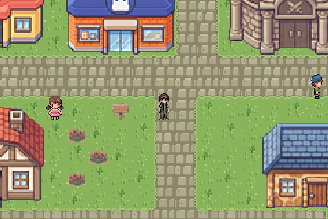
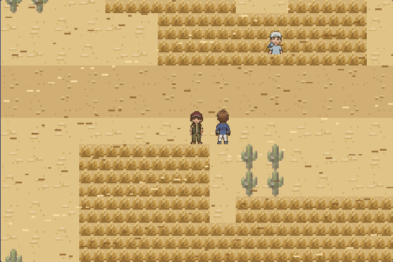
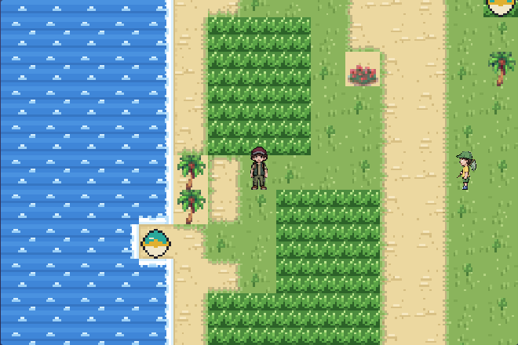
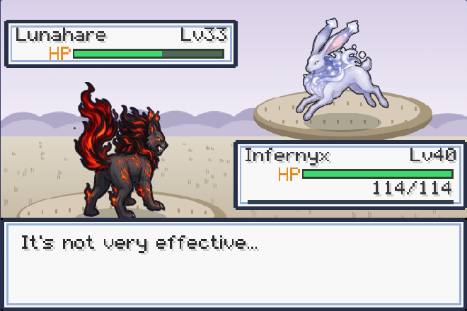
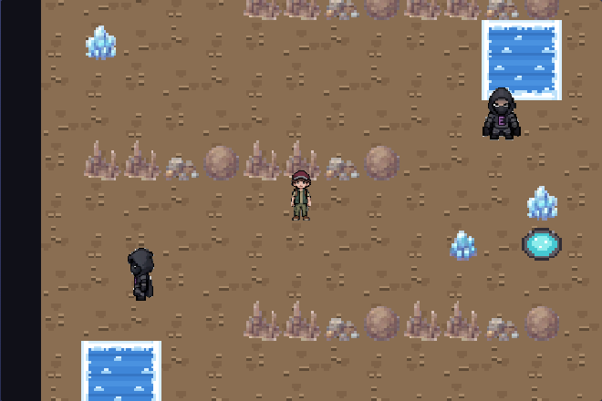
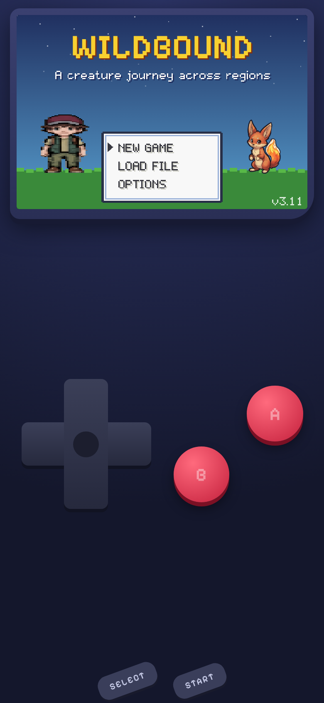
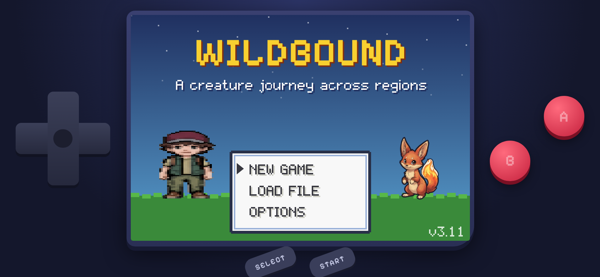

# Wildbound

**An original creature-collecting RPG in the spirit of the handheld classics, built from scratch in vanilla JavaScript on HTML5 Canvas. Three full regions, 359 creatures, and it plays on phones with an on-screen D-pad, installs to the home screen and works offline.**

**Play it:** https://wildbound-pkih.onrender.com

> Free hosting: the first visit after a quiet spell can take ~30–60 s to wake up.

 
 

| | |
| --- | --- |
| **Front end** | Vanilla JavaScript (ES modules, no framework, no bundler), HTML5 Canvas 2D, Web Audio API (chiptune music + SFX), Pointer Events, PWA with offline cache |
| **Back end** | Python 3.12 + Flask, only serves the static game |
| **Saving** | Autosave to localStorage + rolling backup + IndexedDB mirror, plus export/import of a save file |
| **Art pipeline** | Creature and character illustrations generated with AI image tools, then cut, cleaned and sized by my own Python tooling (`tools/`); overworld tiles mix painted props with tiles drawn in code |
| **Testing** | pytest for the server, Node scripts that walk every map and check every creature, Playwright scripts that play the game in a real browser |
| **Deploy** | Render (free plan), auto-deployed from `main` via `render.yaml` |

## The idea

You're a trainer who travels from region to region. Like a long-running anime journey, **each region is a fresh start**: a new professor, three new starters, eight new Gyms and a new League. When you leave a region you pick one or two partners to travel with you; everyone else stays in that region's PC box until you sail back. A ferry links the regions once you're Champion.

## What's in it

**Three regions, each with its own look, Gyms, Elite Four and story**

| Region | Theme | Creatures | Professor |
| --- | --- | --- | --- |
| Aldermoor | classic countryside, mountains and caves | 121 | Maple |
| Meridia | deserts, swamps, snowfields and a volcano | 116 | Cedar |
| Azurine Isles | tropical island chain with beaches, reefs and a volcano | 122 | Marlowe |

- **359 original creatures across 18 types**, every one catchable, including all starters, evolved forms and 12 legendaries. Rare creatures hide in small patches you have to search for.
- **Battle system:** type chart, physical/special split, STAB, crits, PP, priority, stat stages, status effects, drain and recoil, catching, evolution, and 2-on-2 tag battles.
- **Obedience:** in each new region, creatures above your badge level may loaf around instead of listening, so you can't just steamroll with your old team.
- **Rivals Kai & Juno** pick new starters in every region, battle you along the way and team up against you in tag battles. Each region's Champion is one of them.
- **Team Eclipse:** a three-region villain story. Lose to them and they **snatch a creature** from your team (never a starter or a legend), and it turns up on a boss's team later, raised and sometimes evolved.
- **Eclipse hideouts:** after you become Champion of a region, a hidden underground hideout opens somewhere random. It's a one-shot gauntlet with a single-use restore spring and Vex at the end holding your stolen creatures. Leave or lose and it caves in for good. Each region's hideout looks different.
- **Field moves** (Slash, Shatter, Wave Ride, Heave, Glow, Soar) gate new areas in order, and a checker proves each one is needed.
- **Generated routes:** seeded paths, tall grass, trainers who spot you, visible and hidden items, with a checker that guarantees no part of a map is ever cut off.



## Built for phones

 

| Action | Phone | Keyboard |
| --- | --- | --- |
| Move | D-pad | Arrows / WASD |
| A (talk, confirm) | A | Z, Enter, Space |
| B (cancel, hold to run) | B | X, Backspace, Shift |
| Menu | START | Esc / M / Tab |
| Town Map | SELECT | Q |

Portrait phones get a handheld-console layout. Turn the phone sideways and the D-pad and buttons move to either side of the screen. Install it with *Add to Home Screen* to play full-screen and offline.

## Your progress is never lost

- **Autosave** after every map change, battle, heal, menu and PC use, every 30 s, and when the tab is hidden or closed.
- **Two copies + mirror:** each save keeps the previous one as a backup and is mirrored to IndexedDB. The newest valid copy wins on load.
- **Export/import:** START → OPTIONS → EXPORT SAVE gives you a `.json` file you can load on any device.

## Run locally

```bash
python -m venv .venv && source .venv/bin/activate
pip install -r requirements.txt
python app.py              # http://localhost:5000
```

Tests:

```bash
pip install pytest
pytest                       # server routes, PWA files, offline cache list
node tests/check_data.mjs    # every creature catchable, every map valid
node tests/check_reach.mjs   # all 242 maps walkable; each field move gates the next area
```

## How it was built

See [docs/BUILDING.md](docs/BUILDING.md) for the architecture, the art pipeline and how the game is tested and balanced.

## Project layout

```
app.py                 Flask server (static files + PWA routes)
render.yaml            Render blueprint
static/index.html      page + touch controls
static/style.css       handheld-console layout (portrait / landscape / desktop)
static/sw.js           offline cache
static/js/
  engine.js    loop, input (keyboard + touch), layers, fades
  ui.js        text boxes, menus, prompts
  art.js       tiles, props, people and the fallback creature drawer
  data.js      types, moves, items, field moves, obedience caps
  species*.js  the creatures of each region (generated from tools/*/dex.py)
  mon.js       stats, EXP, move learning, evolution
  maps.js      map builder, Aldermoor, beaches, hidden encounter patches
  region2.js   Meridia      region3.js   the Azurine Isles
  hideouts.js  Team Eclipse's hideouts
  world.js     overworld movement, NPCs, doors, grass, trainer sight, surf
  battle.js    battle engine
  screens.js   team, summary, bag, PC, DEX, shop, starter pick, town map
  story.js     scripts, trainers, Gyms, rivals, Team Eclipse, Leagues
  state.js     game state + saving/export/import
  audio.js     chiptune synth
tools/                 art cutting, sprite walk-cycle synthesis, creature data generators
tests/                 pytest + Node checks
```

All creatures, characters, names and story are original. The font is Pixelify Sans (SIL Open Font License, see `static/fonts/OFL.txt`).
