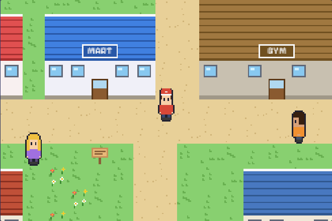
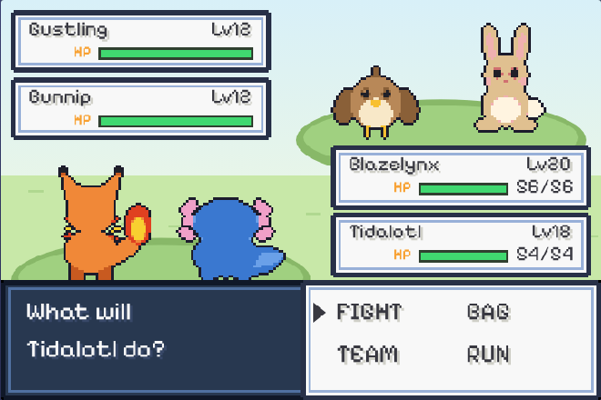

# Wildbound

**A retro creature-collecting RPG in the style of the GBA classics, written from scratch in vanilla JavaScript on HTML5 Canvas. Plays on phones with an on-screen D-pad and A/B buttons, installs to the home screen and works offline.**

 

> Free hosting: the first visit after a quiet spell can take ~30–60 s to wake up.

| | |
| --- | --- |
| **Front end** | Vanilla JavaScript (ES modules), HTML5 Canvas 2D, Web Audio API (chiptune music + SFX), Pointer Events, PWA |
| **Art** | 100% generated in code: creatures are drawn with shapes, then pixelized (hard alpha, palette snap, outline) |
| **Back end** | Python 3.12 + Flask, only serves the static game |
| **Saving** | Autosave to localStorage + rolling backup + IndexedDB mirror, plus export/import of a save file |
| **Deploy** | Render (free plan), auto-deployed from `main` via `render.yaml` |

## The idea

You start as a new trainer who travels from region to region. Like a long-running anime journey, **each region is a fresh start**: a new local starter, new gyms, new creatures. When you leave a region you choose which partners travel with you, and every creature in that region's PC box **stays in that region** until you sail back. Region 1 (Aldermoor) is complete. The ferry to region 2 is the next update.

## What's in v1

- **Region 1: Aldermoor.** Brookhollow (home town), Route 1, Pebbleton (harbor town), Route 2 and Hollow Grove, plus 9 interiors (lab, homes, Healing Center, Mart, Gym).
- **Start like the classics.** Pick 1 of 3 starters at Professor Maple's lab (Sproutmole / Emberkit / Puddlefin).
- **Two rivals: Kai and Juno.** Kai always picks the starter strong against yours and Juno takes the other one. They **take turns** battling you, then **team up** for a 2-on-2 tag battle at the harbor.
- **18 original creatures.** Every one of them is **catchable in the wild**, including the two starters you didn't pick and all evolved forms (rare, in Hollow Grove).
- **Evolution by level or item only.** For example, Buzzlet evolves into Voltwasp with a Spark Stone. There are no trade-only evolutions.
- **Optional trades.** An NPC in Pebbleton trades a Dunepup for a Bunnip. Trading is never required.
- **Team Eclipse.** A recurring villain duo, Nyx and Corvo, who keep showing up with their motto, lose, and retreat ("...for now!").
- **Battle system.** 9 types, a full type chart, physical/special split by type, STAB, crits, accuracy, PP, priority, stat stages, burn/paralysis/sleep, draining and recoil. It supports wild, trainer, double (2v2) and "alternating" two-trainer battles.
- **Training.** EXP split between the creatures that fought, level-ups, learning moves (forget-a-move prompt) and an animated evolution you can cancel with B.
- **Gym:** Leader Shale (Rock), with a gym trainer and a guide.
- **Everything else you'd expect:** catching with orb shakes, Healing Center, Mart (buy/sell), PC box, DEX with entries, bag, trainer card, trainers who spot you, tall grass, running (hold B), blacking out.

## Controls

| Action | Phone | Keyboard |
| --- | --- | --- |
| Move | D-pad | Arrows / WASD |
| A (talk, confirm) | A | Z, Enter, Space |
| B (cancel, hold to run) | B | X, Backspace, Shift |
| Menu | START | Esc / M |

Portrait phones get a Game Boy-style layout. Turn the phone sideways and the D-pad and A/B move to either side of the screen.

## Your progress is never lost

- **Autosave**: after every map change, battle, heal, menu, PC use, and every 30 s. It also saves when the tab is hidden or closed.
- **Two copies + mirror**: each save keeps the previous one as a backup and is mirrored to IndexedDB. The newest valid copy wins on load.
- **Download your save**: START → OPTIONS → EXPORT SAVE gives you a `.json` file. You can load it on any device with IMPORT SAVE or LOAD FILE on the title screen.
- **Install it**: open the site on your phone and use *Add to Home Screen* (iOS: Share → Add to Home Screen). It runs full-screen and offline, and installed apps keep their storage.

## Run locally

```bash
python -m venv .venv && source .venv/bin/activate
pip install -r requirements.txt
python app.py              # http://localhost:5000
```

Tests:

```bash
pip install pytest
pytest                       # server routes, PWA files, offline cache list
node tests/check_data.mjs    # every creature catchable, no trade evolutions, maps valid
```

## Deploy on Render

New → **Blueprint** → pick this repo. `render.yaml` sets up a free web service that redeploys on every push to `main`.

## Growing the game

- **New creature**: add it to `SPECIES` in `static/js/data.js` (stats, types, learnset, `evo: {to, level}` or `{to, item}`), add a drawer under its `family` in `static/js/art.js`, and put it in an encounter table in `static/js/maps.js`. `tests/check_data.mjs` fails if it can't be caught anywhere.
- **New region**: add maps with `region: '<id>'` in `maps.js`. Boxes are already stored per region (`G.boxes[region]`), and `G.partners` is reserved for the creatures that travel with you.
- **New trainers / story**: `static/js/story.js` (trainers, rival teams, Team Eclipse scenes).

## Project layout

```
app.py                 Flask server (static files + PWA routes)
render.yaml            Render blueprint
static/index.html      page + touch controls
static/style.css       handheld-console layout (portrait / landscape / desktop)
static/sw.js           offline cache
static/js/
  engine.js   loop, input (keyboard + touch), layers, fades
  ui.js       text boxes, menus, prompts
  art.js      procedural pixel art (creatures, people, tiles, buildings)
  data.js     types, moves, creatures, items
  mon.js      stats, EXP, move learning, evolution
  maps.js     Aldermoor maps
  world.js    overworld movement, NPCs, doors, grass, trainer sight
  battle.js   battle engine
  screens.js  team, summary, bag, PC, DEX, shop, starter pick, options, evolution
  story.js    scripts, rivals, Team Eclipse, gym
  state.js    game state + saving/export/import
  audio.js    chiptune synth
```

All creatures, characters, names and art are original. The font is Pixelify Sans (SIL Open Font License, see `static/fonts/OFL.txt`).
